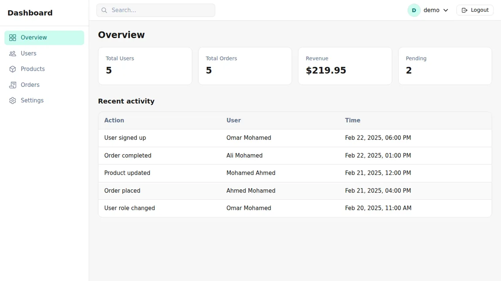

# Admin Dashboard

A React dashboard demo for managing users and products and reviewing orders. It showcases reusable data tables, filters, pagination, forms, confirmation dialogs, skeletons, and toast feedback.



## Run locally

Use Node.js 22.12+ and npm.

```bash
npm ci
npm run dev
```

Open the URL printed by Vite. For the demo sign-in, use a fictional email such as `demo@example.com` and any nonempty demo password. Sign-in is simulated in the browser. [The mock API](src/services/api.js) stores records in memory, so refreshing resets edits. No backend or environment file is needed.

| Command | Purpose |
| --- | --- |
| `npm run build` | Generate the static build |
| `npm run lint` | Run ESLint |

**Stack:** React, React Router, Vite, and CSS Modules. See [`src/components/ui/`](src/components/ui/) for reusable controls and [`src/pages/`](src/pages/) for feature screens.
